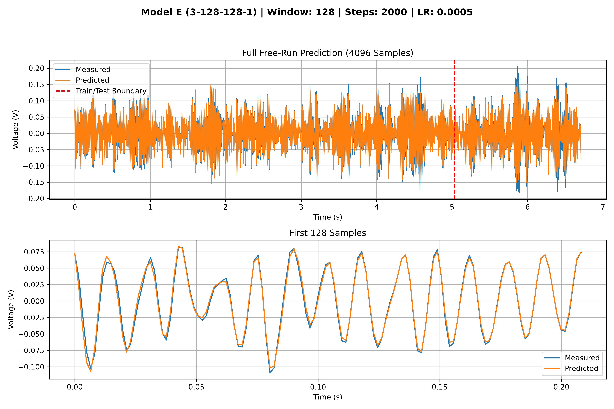
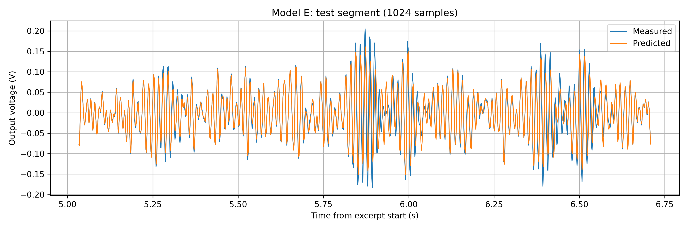
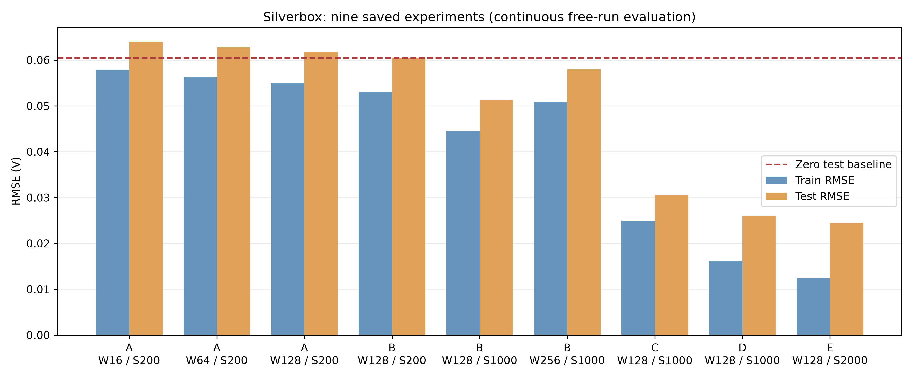

# Silverbox oscillator: neural acceleration model

Homework 1, Task 5 for PhotonicsAI: AI-Driven Science and Autonomous Laboratories.
The project learns the acceleration of the Silverbox oscillator with a PyTorch
network and integrates its state using classical fourth-order Runge-Kutta (RK4).

## Model and numerical method

The physical reference equation is

```text
y'' + a*y' + b*y + c*y^3 = g*u(t)
```

The implemented state equation is `y' = v`, `v' = alpha_theta(y, v, u)`.
The network learns acceleration directly; it does not fit explicit values of
`a`, `b`, `c`, or `g`, and the loss contains no separate physics-residual penalty.
The state equation and differentiable integrator provide the dynamical structure.

The selected Model E has architecture **3-128-128-1**, with Tanh activations in
both hidden layers and a linear output. Inputs `[y, v, u]` are divided by
`[0.1, 40.0, 0.05]`; the network output is multiplied by `20000.0`.
These fixed scales are identical across the saved experiments.

Each RK4 step uses the measured input at both endpoints and their average at
the midpoint. Training uses randomly selected windows from the training record.
Each window starts from its measured output and a forward finite-difference
output derivative. The objective is mean squared output error through the
window. Optimization uses Adam and gradient clipping with maximum norm 1.0.
Model E uses a window of 128 samples, 2000 optimizer steps, learning rate 0.0005,
and `torch.manual_seed(42)`. A step is one sampled window, not a full epoch.
The original CPU float32 calculation is preserved.

## Data and evaluation protocol

Place the public Silverbox file `SNLS80mV.mat` in `data/raw/`.
The existing dataset files and their original README files are preserved.
The source is the [Silverbox benchmark](https://www.nonlinearbenchmark.org/).

- Input: MATLAB channel `V1`; output: channel `V2`.
- Sampling frequency: 610.35 Hz; time step: `1 / 610.35` seconds.
- Python excerpt: `[42650:46746]`, containing 4096 samples.
- Subtract each signal's mean over the **whole excerpt**, as explicitly required
  by the homework, before splitting.
- Training: first 3072 centered samples; testing: last 1024.

Evaluation starts once at the beginning of the excerpt, using the measured
initial output and its forward finite-difference derivative. One continuous
4096-sample free run spans both segments. **The state is not reset at the test
boundary.** After initialization the rollout receives input voltage only;
measured output is used for scoring and plotting, not state correction.

The zero baseline is the RMSE of predicting zero on the centered test output.
The test plot uses the last 1024 predictions from this same free run.

## Verified results

The table below is recomputed from the saved checkpoints. More precise metrics,
checkpoint paths and figure paths are in
[`results/tables/experiment_results.csv`](results/tables/experiment_results.csv).

| Model | Architecture | Window | Steps | LR | Train RMSE (V) | Test RMSE (V) |
|---|---|---:|---:|---:|---:|---:|
| A | 3-4-4-1 | 16 | 200 | 0.001 | 0.057884 | 0.063896 |
| A | 3-4-4-1 | 64 | 200 | 0.001 | 0.056296 | 0.062778 |
| A | 3-4-4-1 | 128 | 200 | 0.001 | 0.054946 | 0.061760 |
| B | 3-16-16-1 | 128 | 200 | 0.001 | 0.053053 | 0.060466 |
| B | 3-16-16-1 | 128 | 1000 | 0.001 | 0.044517 | 0.051304 |
| B | 3-16-16-1 | 256 | 1000 | 0.001 | 0.050899 | 0.057952 |
| C | 3-32-32-1 | 128 | 1000 | 0.001 | 0.024891 | 0.030593 |
| D | 3-64-64-1 | 128 | 1000 | 0.0005 | 0.016129 | 0.026024 |
| **E** | **3-128-128-1** | **128** | **2000** | **0.0005** | **0.012396** | **0.024516** |

The zero baseline is **0.060492 V**. Model E's test RMSE is about 24.5 mV,
59.5% lower than the zero baseline. It is the best of the nine primary saved
experiments under the assignment's metric.







### Interpretation and historical files

The assignment explicitly requests selecting the best test score. Accordingly,
this test record was used for model comparison; the selected score is not an
independent, untouched final test estimate. Full-excerpt centering also follows
the assignment rather than a general train-only preprocessing protocol.

Some comparisons change multiple settings at once: C to D changes width and
learning rate; D to E changes width and training steps. The measured improvement
cannot be attributed to width alone. The current training script uses Adam. No additional optimizer sweep is claimed.

`results/checkpoints/model_a.pt` is an earlier extra run, distinct from
`model_a_w16.pt`. Its recomputed train/test RMSE is approximately
9.228715/18.489641 V. It and its original figure are preserved, but it is excluded
from the nine primary experiments. Its separate results can be regenerated with
the single-checkpoint evaluation command below. Original figures are retained;
new evaluation figures are named after their actual checkpoint stems.

## Project structure

```text
README.md
requirements.txt
.gitignore
scr/                         # Existing folder name preserved
    data_handler.py          # Excerpt, prescribed centering, metadata
    model.py                 # Scaled acceleration network
    integrator.py            # Differentiable RK4 step and rollout
    train.py                 # Random-window training and checkpoint saving
    evaluate.py              # Continuous free-run scoring, figures, CSV
    visualize.py             # Centered input/output visualization
    compare_experiments.py   # Comparison chart from the verified CSV
    validate.py              # Preprocessing and integrator checks
data/
    raw/                     # Original dataset and source notes
    processed/silverbox_excerpt.npz
results/
    checkpoints/             # Saved experiments; retained for comparison
    figures/                 # Original and regenerated plots
    tables/                  # Recomputed experiment metrics
```

## Setup

Verification used Python **3.14.6** and the exact package versions in
`requirements.txt`. To create an isolated environment with that Python version:

```bash
python3.14 -m venv .venv
source .venv/bin/activate
python -m pip install -r requirements.txt
```

All commands below run from the repository root. No absolute user-specific paths
are required. Model loading uses `torch.load(..., weights_only=True)` on CPU.

## Run the saved experiments

```bash
# Prepare the prescribed excerpt and inspect its signals.
python scr/data_handler.py
python scr/visualize.py --no-show

# Model E: save full-run and test-segment plots, plus a single-model CSV.
python scr/evaluate.py --no-show

# Recompute the comparison table and figures for all nine primary experiments.
python scr/evaluate.py --all --no-show
python scr/compare_experiments.py

# Evaluate the earlier extra Model A run separately.
python scr/evaluate.py --checkpoint results/checkpoints/model_a.pt --no-show

# Check the raw-to-processed data and analytical RK4 cases.
python scr/validate.py
```

Omit `--no-show` to display evaluation figures interactively. For evaluation on a
machine without a display, set `MPLBACKEND=Agg`. `--output-dir` can put evaluation
figures and CSV files in another directory. Single-model evaluation never
replaces the complete nine-experiment CSV.

## Train another copy of an experiment

The default configuration is Model E. Training deliberately refuses to overwrite
an existing checkpoint. Choose a new checkpoint path to repeat training:

```bash
python scr/train.py --checkpoint results/checkpoints/repeat_model_e.pt
```

All existing settings can be selected without editing the script, for example:

```bash
python scr/train.py --model-name model_c --hidden-size 32 --steps 1000 \
  --window 128 --learning-rate 0.001 \
  --checkpoint results/checkpoints/repeat_model_c.pt
```

Check the resulting checkpoint with `evaluate.py --checkpoint ...`.
A fixed seed improves reproducibility, but retraining on another runtime or
platform is not guaranteed to reproduce every saved weight exactly.
The reported table evaluates the already saved experiments; it does not claim
that all nine were retrained during cleanup.

## Cleanup verification

See [`results/validation_summary.md`](results/validation_summary.md) for the
checks actually run during cleanup.

## GitHub preparation

The code, processed excerpt, checkpoints, plots and result tables are retained.
`.gitignore` excludes virtual environments, Python caches, macOS metadata,
editor settings, temporary work and local `.env` files. This folder has not yet been published to GitHub. Add its repository link to the
final homework PDF after publication. The LaTeX write-up is a separate next step.
